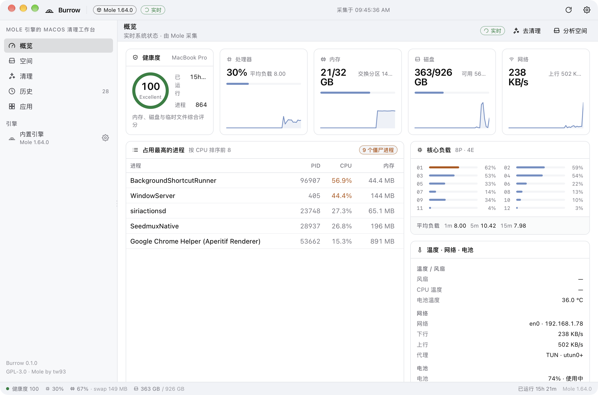

# Burrow

[](https://github.com/dousha0w0/burrow/actions/workflows/ci.yml)
[](https://github.com/dousha0w0/burrow/releases)

一个 macOS 桌面清理与磁盘分析工具，**底层引擎是 [tw93/Mole](https://github.com/tw93/Mole)**。界面沿用 DriveDesk 那套工作台设计（设计变量 / 浅深色与三套配色 / 双布局 / 可拖拽侧栏 / 紧凑表格 / 中英双语）。

Mole 负责扫描、保护名单、删除与日志；Burrow 只负责把它的 JSON 输出变成可读的界面，并在需要交互的地方把控制权交回终端。



---

## 为什么是「前端」

Mole 已经是一个成熟、经过安全审计的命令行工具：缓存规则、白名单、`--dry-run`、撤销到废纸篓、操作日志都在它里面。Burrow 不重写这些规则，只驱动它的机器可读出口：

| 能力 | 引擎入口 |
| --- | --- |
| 实时状态（CPU / 内存 / 磁盘 / 网络 / 电池 / 温度 / 进程） | `mo status --json`、`mo status --watch --interval Ns` |
| 磁盘分析（整机概览与逐层下钻） | `mo analyze --json <path>` |
| 系统垃圾预览与清理 | `mo clean --dry-run`、`mo clean` |
| 项目构建产物清理 | `mo purge --dry-run`、`mo purge --yes` |
| 历史与删除记录 | `mo history --json` |
| 已安装应用清单 | `mo uninstall --list` |

清理摘要（`Potential space:` / `Tracked cleanup:` 等）由 `src/lib/parse-run.ts` 解析，配了单元测试；其它命令直接用 Mole 的 JSON，不做二次推断。

## 功能

**概览**
- 健康度环、CPU / 内存 / 磁盘 / 网络四张指标卡，带 90 个采样点的走势线
- 核心负载（P/E 核）、平均负载、交换分区、缓存
- 电池、温度、风扇、网络接口与代理状态
- 进程占用前 8 名（CPU / 内存）
- 跟随 `mo status --watch` 流式刷新，间隔可调（1/2/5/10 秒）

**空间**
- 整机概览或任意目录的逐层下钻，`partial` 状态会显式标注（权限不足的目录被跳过）
- 当前层的矩形树图（面积即大小），点一下进入子目录
- 名称 / 大小 / 占比 / 类型表格，可排序；右键复制路径、在 Finder 中显示

**清理**
- 「系统垃圾」与「项目缓存」两个入口，先预览后执行
- 预览按分类渲染（应用缓存、虚拟化、Application Support、大文件…），原始日志同时保留
- 执行前有确认弹窗；运行中可停止；结束后展示回收量与状态
- 图形界面以非交互方式运行，**需要 sudo 的系统缓存会被跳过**（Mole 的既定行为），面板会明确提示；需要完整清理时一键在终端打开
- 会话内运行记录，可随时回看日志

**历史**
- `mo history` 的会话表：命令、开始时间、耗时、项目数、大小、删除/废纸篓/跳过计数
- 累计回收量、实际删除次数；操作日志与删除日志可直接在 Finder 中定位

**应用**
- `mo uninstall --list` 的完整清单，支持搜索、来源标记
- 卸载交给终端里的 Mole 完成：它会逐项列出 LaunchAgents、偏好设置与残留让你确认，这是比在图形界面里一键删除更安全的做法

**外壳**
- 浅色 / 深色 / 跟随系统 × 3 套配色（中性 / 石墨 / VS Code）× 3 种圆角
- 经典紧凑 / 现代分隔两套布局，行密度舒适 / 紧凑
- 侧栏可拖拽调宽并持久化；macOS Overlay 标题栏 + 红绿灯内嵌，首帧就绪后才显示窗口
- ⌘1–⌘6 切换页面，⌘R 重新采集，⌘, 打开设置

## 引擎打包

Mole 以 git submodule 固定在 `vendor/mole`（当前 V1.64.0）。`scripts/sync-engine.sh` 把它整理成 Tauri 资源：

```
src-tauri/engine/
├── mo, mole          # 入口脚本
├── lib/              # Mole 的清理与安全检查实现
└── bin/
    ├── *.sh          # 子命令
    ├── status-go     # 由 cmd/status 编译
    └── analyze-go    # 由 cmd/analyze 编译
```

应用启动时优先使用内置引擎（版本可复现），找不到才回退到 `/opt/homebrew/bin/mo` 或 `PATH` 里的 `mo`。引擎路径与版本在设置页可见。

## 开发

```sh
pnpm install
bash scripts/sync-engine.sh      # 需要 Go：编译 status-go / analyze-go
pnpm tauri dev                   # Vite 1420 + Tauri
```

只调界面、不启动 Tauri 时：

```sh
pnpm dev                         # 浏览器里跑 mock 数据（src/lib/mock.ts）
pnpm test                        # 解析器单元测试
pnpm typecheck
```

## 构建

```sh
bash scripts/sync-engine.sh
pnpm tauri build --bundles app,dmg
```

CI 使用两个原生 runner 分别构建 arm64 与 x86_64；产物未签名、未公证，首次打开需要右键「打开」或在系统设置里放行。要签名时在仓库里配置 `APPLE_CERTIFICATE`、`APPLE_CERTIFICATE_PASSWORD`、`APPLE_SIGNING_IDENTITY` 等 secrets 即可。

## 结构

```
src/
├── App.vue                 # 外壳：工具栏 / 侧栏 / 工作区 / 状态栏
├── components/
│   ├── layout/             # 外壳三件套
│   ├── ui/                 # 按钮、图标、刻度盘、走势线、分段控件…
│   ├── overview/ space/ clean/
├── stores/                 # engine / status / space / runs / history / apps / ui
├── lib/
│   ├── bridge.ts           # 唯一的 IPC 入口，浏览器里自动切 mock
│   ├── parse-run.ts        # CLI 文本摘要与预览分组
│   └── mock.ts             # 演示数据（与真实 JSON 同构）
├── styles/                 # 设计变量 + 全局外观
└── views/                  # 六个页面
src-tauri/
├── src/engine.rs           # 引擎定位、版本探测
├── src/process.rs          # 子进程、ANSI 清理、行流
├── src/status.rs space.rs runs.rs query.rs system.rs
└── engine/                 # 构建产物，运行时被打进 Resources
```

## 边界与取舍

- **需要 sudo 的清理**不会在图形界面里收集密码。Mole 的非交互模式本来就会跳过系统级缓存；要完整清理请用面板上的「在终端中运行完整清理」。
- **卸载应用**同样交给终端：Mole 的卸载器需要逐项确认残留，图形化一键删除会绕过这层确认。
- 所有命令在本机执行，不上传任何数据；日志写在 `~/Library/Logs/Burrow/burrow.log`。
- 仅支持 macOS，与 Mole 的 `main` 分支一致。

## 许可

Burrow 以 **GPL-3.0** 发布，因为发行包里包含同样以 GPL-3.0 授权的 Mole 引擎（`vendor/mole` 指向其源码）。清理逻辑、保护名单与安全判断的功劳属于 [tw93](https://github.com/tw93) 与 Mole 的贡献者；Burrow 只是它的一个工作台。
